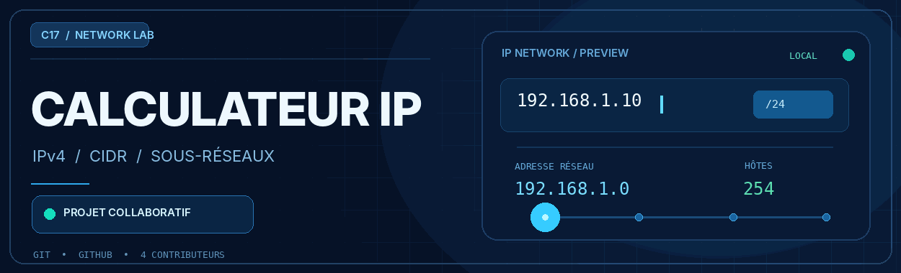

<div align="center">



<br />

**Un calculateur IPv4 clair, rapide et entièrement local.**  
*Projet de groupe en systèmes & réseaux, développé à quatre avec Git et GitHub.*

<br />


</div>

---

## 01 / Le projet

**Calculateur IP** est une application web qui permet de retrouver les informations essentielles d'un réseau IPv4 à partir d'une adresse IP et d'un masque CIDR.

Le projet fonctionne **dans le navigateur**, sans serveur, sans machine virtuelle et sans installation d'infrastructure.

## 02 / Fonctionnalités prévues

| Module | Fonctionnalités |
| :--- | :--- |
| **Calcul IPv4** | Adresse réseau, broadcast, première et dernière IP utilisables, nombre d'hôtes. |
| **Sous-réseaux** | Découpage d'un réseau, nouveaux masques CIDR et plages d'adresses. |
| **Validation** | Vérification des adresses IP, masques et saisies incorrectes. |
| **Interface** | Formulaire simple, résultats lisibles et tableau de sous-réseaux. |

<details>
<summary><b>Exemple de calcul IPv4</b></summary>
<br />

Pour une adresse `192.168.1.10/24` :

| Information | Résultat |
| :--- | :--- |
| Adresse réseau | `192.168.1.0` |
| Broadcast | `192.168.1.255` |
| Première IP utilisable | `192.168.1.1` |
| Dernière IP utilisable | `192.168.1.254` |
| Hôtes utilisables | `254` |

</details>

## 03 / L'équipe

| Membre | Rôle | Mission | Suivi |
| :--- | :--- | :--- | :---: |
| **Marwan · C17** | **Leader du projet** | Interface HTML/CSS et coordination du groupe | [#1](../../issues/1) |
| **Tom** | Développement | Calculateur IPv4 | [#2](../../issues/2) |
| **Socrates** | Développement | Calculateur de sous-réseaux | [#3](../../issues/3) |
| **Samy** | Qualité & documentation | Tests, vérifications et README | [#4](../../issues/4) |

## 04 / Travail collaboratif

Le code est partagé dans **un dépôt GitHub commun**. Chaque membre utilise son propre compte et travaille sur une branche dédiée.

```text
main
├── marwan-interface
├── tom-ipv4
├── socrates-subnet
└── samy-tests
```

**Notre méthode :** une tâche par personne → une branche Git → des commits → une Pull Request → une relecture → fusion dans `main`.

Les tâches et leur progression sont suivies dans les **Issues** et le **GitHub Project** du groupe.

## 05 / Progression

- [ ] Interface HTML/CSS
- [ ] Calcul IPv4
- [ ] Calcul des sous-réseaux
- [ ] Tests et documentation

## 06 / Technologies

`HTML` · `CSS` · `JavaScript` · `Git` · `GitHub`

Aucune dépendance serveur n'est nécessaire. Une fois l'application développée, il suffira d'ouvrir `index.html` dans un navigateur.

---

<div align="center">

<sub>CALCULATEUR IP · C17 NETWORK LAB · PROJET COLLABORATIF</sub>

</div>
